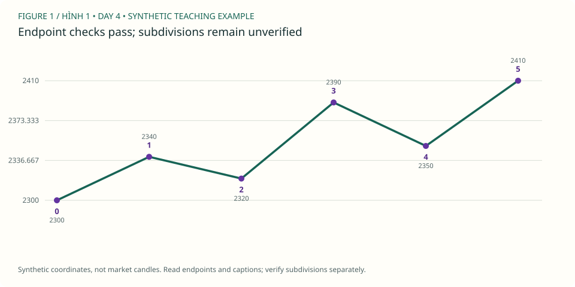
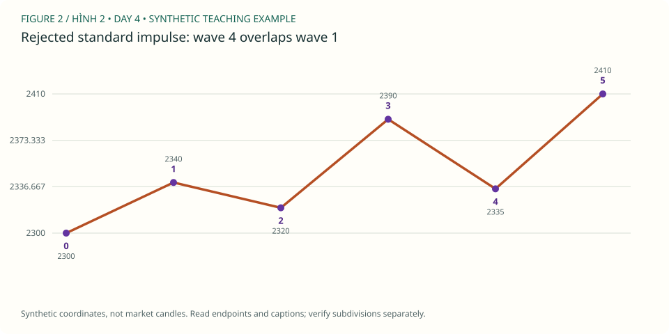
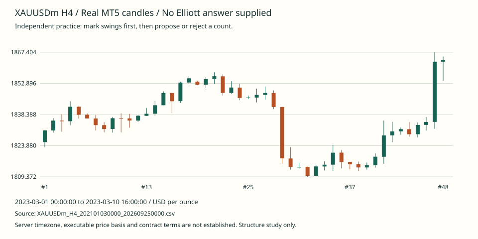

# Unit 04 — Kiểm tra impulse / Auditing a standard impulse

**Trình tự mới:** [Roadmap](../Roadmap.md) · [Cấu trúc một unit](../Unit-structure.md)  
**Tiên quyết / Prerequisites:** swing, parent/child degree, phân biệt quan sát và nhãn giả thuyết.  
**Thời lượng / Duration:** 90–120 phút, có thể chia hai buổi / Split into two sessions if needed.

## 1. Mục tiêu và đọc nguồn / Outcomes and source reading

Sau bài này bạn có thể / By the end you can:

1. Đánh dấu sáu endpoint 0–1–2–3–4–5 và tính độ dài 1/3/5. / Mark six endpoints and measure motive-wave lengths.
2. Loại một standard impulse vi phạm origin, shortest-wave hoặc overlap. / Reject price-rule violations.
3. Giải thích vì sao vượt qua kiểm tra endpoint chưa chứng minh count đúng. / Explain the limits of endpoint-only validation.
4. Nộp bản vẽ XAUUSD có nguồn, cutoff và alternative/no-count. / Submit a reproducible chart study.

**Đọc:** [PDF trang 14–17](../data/Elliott-waves-made-simple-mast-steve-sinclair.pdf#page=14). Quan sát cách tác giả gắn nhãn và ba điều kiện giá. Với overlap, dùng **vùng wave 1** theo định nghĩa standard impulse trong khóa học, không học máy móc cách diễn đạt “wave 2 territory” của nguồn.

**English:** Inspect the source's motive-wave examples and compare their endpoints against the rules below. These notes are original explanations, not a transcription of the book. The new illustrations use hypothetical gold-price coordinates; they do not reproduce its charts.

## 2. Ôn nhanh / Recall before reading the answers

- Swing high khác wave 1 thế nào? / How does an observed swing high differ from an inferred wave-1 endpoint?
- H4 có luôn là cùng một wave degree không? / Does H4 always represent one fixed degree?
- Pivot cần hai nến phải: khi nào biết nó? / When is a pivot knowable under a two-right-bar convention?

**Tự trả lời / Your response:** ______________________________

Đáp án recall / Recall key

Swing là quan sát theo quy ước chọn pivot; nhãn Elliott là suy luận về vai trò và degree. H4 chỉ là cách lấy mẫu thời gian, không ấn định degree. Pivot chỉ được xác nhận sau hai nến bên phải hoàn thành và điều kiện vẫn đúng.

An observed swing is not automatically a wave endpoint. Timeframe does not uniquely determine degree. A two-right-bar pivot becomes knowable only after both required bars close and the pivot test still holds.

## 3. Bốn nguyên lý / Four principles

### P1 — Wave 2 không vượt origin / Protect the origin

**VI:** Với giả thuyết standard impulse tăng, origin là điểm bắt đầu wave 1, không phải đáy wave 2 bạn thích nhất. Wave 2 không được đi xuống vượt origin. Với impulse giảm, điều kiện đối xứng: wave 2 không được đi lên vượt origin. Kiểm tra bằng cực trị trong toàn bộ đoạn, không chỉ giá đóng cửa hoặc endpoint bạn chọn. Nếu râu nến đã vi phạm rồi giá quay lại, giả thuyết cũ vẫn đã thất bại. Không di chuyển origin để giữ dự báo. Khóa học bảo thủ coi chạm origin là trường hợp cần loại/kiểm tra lại; đó là quy ước bài tập cần ghi rõ.

**EN:** For a bullish standard impulse, the origin is the start of wave 1, not a later convenient low. Wave 2 must not travel beyond that origin. Reverse the comparison for a bearish impulse. Inspect the extremes throughout the interval rather than only the selected endpoint or candle close. A recovery after an intrabar breach does not undo the breach. Do not move the origin simply to preserve a preferred forecast. This course conservatively flags an exact touch for rejection or review; state that boundary convention explicitly rather than presenting it as a universal execution rule.

**Check:** origin2300, wave2 low2299 nhưng close2310: còn hợp lệ không? / Is a close back above2300 enough?

### P2 — Wave 3 không ngắn nhất / Wave 3 need not be longest

**VI:** Đo khoảng giá tuyệt đối của wave 1, 3 và 5 ở cùng degree. Wave 3 không được ngắn hơn cả hai sóng còn lại. Nó có thể ngắn hơn wave 1 nhưng dài hơn wave 5. Vì wave 5 có thể chưa kết thúc, đôi khi phải ghi “chưa quyết định được”, không chấm sớm là pass cuối cùng. Wave 3 còn cần tiến vượt điểm kết thúc wave 1 theo hướng motive. Độ dốc, số nến và màu nến không thay thế khoảng giá. Không dùng RSI hoặc mức161,8% để bỏ qua một lỗi shortest-wave đã thấy rõ.

**EN:** Measure the absolute price distances of waves 1, 3 and 5 at the same degree. Wave 3 must not be shorter than both other motive waves. It may be shorter than wave 1 while remaining longer than wave 5. If wave 5 is incomplete, the final shortest-wave comparison may still be undecidable. Wave 3 must also progress beyond wave 1 in the motive direction. Slope, candle count and candle color are not substitutes for price distance. Neither an attractive Fibonacci ratio nor oscillator strength rescues a clear shortest-wave violation.

**Check:** lengths80/60/40: wave3 có sai không? / Is wave3 invalid merely because it is not longest?

### P3 — Wave 4 không overlap wave 1 / Standard impulse territory

**VI:** Với impulse tăng, vùng wave 1 nằm giữa origin và đỉnh wave 1. Wave 4 phải giữ phía trên đỉnh đó theo quy ước bảo thủ của bài. Với impulse giảm, wave 4 phải ở dưới đáy wave 1. Kiểm tra toàn bộ đường giá được quan sát, kể cả wick chen giữa hai nhãn. Nếu thấy overlap, kết luận đúng đầu tiên là “không phải standard impulse theo count này”. Không tự đổi thành diagonal: diagonal cần vị trí phù hợp, cấu trúc con và hình học riêng. Đỉnh wave 5 cao hơn sau đó không xóa lỗi wave 4 trước đó.

**EN:** In a bullish standard impulse, wave-1 territory lies between the origin and the wave-1 high. Under this lesson's conservative convention, wave 4 must remain above that high. Reverse the comparison for a bearish sequence. Check all observed extremes, including intervening wicks, not only the endpoints chosen for the drawing. If overlap occurs, reject this standard-impulse interpretation first. Do not automatically rename it a diagonal: that requires appropriate placement, subdivisions and geometry. A later wave-5 high cannot retrospectively repair the earlier price-rule failure.

**Check:** wave1 high2340, wave4 low2335: giá sau lên2410 có sửa được lỗi không? / Can later progress repair overlap?

### P4 — Rule audit không phải chứng nhận / Passing is not proof

**VI:** Sáu điểm giá chỉ cho biết một số ràng buộc hình học. Bạn còn phải kiểm tra cấu trúc bên trong, degree, vị trí trong parent wave và các nhãn thay thế. Một công cụ báo không thấy vi phạm có nghĩa hẹp hơn nhiều so với “đếm đúng”. Khi chưa nhìn H1 phù hợp, ghi rõ internals chưa kiểm chứng. Khi đoạn giá còn mở, để endpoint cuối ở trạng thái provisional. Luyện tập tốt không phải luôn có count, mà là biết khi nào nên bỏ nhãn hoặc giữ hai phương án. Không biến hình mẫu này thành kế hoạch mua bán.

**EN:** Six prices reveal only a subset of structural constraints. Subdivisions, degree, parent-wave placement and alternative interpretations still need review. A tool reporting no detected violation makes a much narrower claim than certifying a correct count. If the relevant lower-timeframe evidence has not been inspected, mark the internals as unverified. If the move remains open, treat the final endpoint as provisional. Good practice includes removing labels or retaining alternatives when evidence is insufficient. A price-rule audit is not a forecast, a trade recommendation or evidence that a trading strategy has an edge.

**Check:** nếu chưa xem internals, câu kết luận nào trung thực nhất? / What can you honestly conclude without subdivisions?

## 4. Hai hình giảng dạy mới / Two original illustrations

### Hình A — Chưa thấy lỗi endpoint / No endpoint violation detected

**VI:** Đây là các tọa độ giả định USD/oz, không phải nến MT5. Wave2 cao hơn origin, wave3 vượt wave1 và không ngắn nhất, wave4 ở trên đỉnh wave1. Kết luận chỉ là endpoint candidate vượt qua các điều kiện này.

**EN:** These are hypothetical USD/oz coordinates, not MT5 candles. The selected endpoints meet the checks discussed here. Subdivisions and unobserved intermediate prices remain unverified; this is not a certified Elliott count.

### Hình B — Bị loại vì overlap / Rejected for overlap

**VI:** Chỉ đổi điểm4 từ2350 xuống2335. Wave4 đã nằm trong wave1 territory, nên bác bỏ standard impulse này. Không dùng đỉnh5 hoặc một tỷ lệ Fib để cứu count.

**EN:** Only endpoint4 changes. It now lies inside wave-1 territory, so this standard-impulse interpretation fails. A later high does not reverse that decision. A diagonal would require a separate, evidenced hypothesis.

## 5. Giải từng bước / Worked audit

| Endpoint | Price USD/oz | Quan sát / Observation |
|---|---:|---|
| 0 | 2300 | Proposed origin |
| 1 | 2340 | Wave-1 endpoint |
| 2 | 2320 | Above origin |
| 3 | 2390 | Beyond wave1 |
| 4 | 2350 | Above wave1 high |
| 5 | 2410 | Final endpoint for this exercise only |

1. **Distances:** L1=|2340−2300|=40; L3=|2390−2320|=70; L5=|2410−2350|=60.
2. **Origin:** 2320>2300: pass at selected endpoint.
3. **Progress:** 2390>2340: pass.
4. **Shortest:** 70 is not shorter than both40 and60: pass for the completed hypothetical skeleton.
5. **Overlap:** 2350>2340: pass at selected endpoint.
6. **Limits:** no timestamps or intermediate candles in this synthetic drawing; cannot assess intervening breaches or internals.

**VI:** Trước tiên xác định pattern đang kiểm tra là standard impulse tăng và mọi nhãn ở cùng degree. Sau đó đo khoảng giá, không đo số nến. Ba điều kiện chính không thấy vi phạm trong hình A, nhưng chưa kiểm chứng dữ liệu giữa các điểm, cấu trúc con hay parent context. Nếu đổi wave4 thành2335, độ dài wave5 đổi thành75, nhưng điều đó không quan trọng để cứu count: overlap đã đủ bác bỏ. Hình B vì vậy phải sửa giả thuyết hoặc gỡ nhãn. Không kéo điểm4 trở lại2350 chỉ để hình trông đẹp.

**EN:** First define the hypothesis as a bullish standard impulse whose labels share one degree. Measure price distances rather than elapsed candles. Figure A shows no selected-endpoint violation, but it supplies neither intermediate candles nor evidence for subdivisions and parent placement. Moving endpoint4 to2335 changes wave5's length to75; that does not rescue the interpretation because overlap already rejects it. Revise the hypothesis or remove the labels. Do not move the endpoint back to a convenient price merely to preserve the diagram.

## 6. Tự vẽ trên nến thật / Independent real-chart exercise

**Nguồn / Source:** [H4 MT5 export](../data/Mt5Data/XAUUSDm_H4_202101030000_202609250000.csv), 48 nến liên tiếp bắt đầu từ nến đầu tiên có timestamp ≥2023-03-01. Hình hiển thị chính xác đầu/cuối cửa sổ. Metadata SVG chứa source SHA-256 và OHLC để đối chiếu. Đây là bài tập quan sát, không phải ví dụ impulse được xác nhận.

**VI:** Timestamp là giờ server, offset chưa biết. Không dùng timestamp như UTC hoặc giả định symbol có thông số hợp đồng tiêu chuẩn. Hình tĩnh không tự lưu nét vẽ; mở SVG trong công cụ annotation hoặc in ra. Để vẽ tương tác có thể dùng [lab standard impulse cũ](../days/day-03.html), nhưng đó là **day03 của phiên bản cũ**, cửa sổ chart có thể khác; ghi đúng nguồn của bài bạn nộp.

**EN:** The chart preserves the supplied candle prices and server timestamps. The timezone offset, executable price basis and contract terms are unknown. The static SVG does not save annotations; annotate a copy externally or use the explicitly legacy interactive lab. Do not mix a legacy lab's window identity with this sample's candles.

### Nhiệm vụ / Assignment

1. Chỉ đánh dấu swing trước; ghi quy ước chọn pivot. / Mark swings first and state your pivot convention.
2. Đề xuất một candidate 0–5 nếu có. Không có thì nộp no-count và lý do. / Propose a candidate only if supported.
3. Lập bảng timestamp, high/low, giá, nhãn và degree. / Record exact endpoint evidence.
4. Kiểm tra origin, wave3, overlap bằng cả intervening wicks. / Check extremes between selected endpoints.
5. Ghi một alternative hoặc điều chưa biết. / Record an alternative or unresolved evidence.
6. Lưu bản gốc trước khi đọc nhận xét. / Preserve the original drawing.

Lặp lại trên **3 cửa sổ độc lập** trong lịch sử rộng hơn. Hình48 nến là starter case, không bảo đảm đủ ba impulse hoặc đủ dữ liệu H1. Không ghi “đạt” bằng cách dùng cùng một hình ba lần.

## 7. Mười câu kiểm tra / Ten questions

Trả lời trước rồi mới mở đáp án. / Write your reasoning before opening the key.

### Q1 — Khái niệm / Definition
Ba hard price rules chính của standard impulse là gì? Wave3 có bắt buộc dài nhất không? / State the three principal hard price rules. Must wave3 be longest?

**Trả lời / Response:** ______________________________

### Q2 — Origin breach
Origin2300, wave2 có low2298 và close2315. Count tăng có còn qua origin test không? / Does closing at2315 repair a wave-2 low of2298?

**Trả lời / Response:** ______________________________

### Q3 — Đo độ dài / Length arithmetic
Tính L1/L3/L5 trong hình A và xác định wave3 có ngắn nhất không. / Calculate the motive lengths in figure A.

**Trả lời / Response:** ______________________________

### Q4 — Không dài nhất / Not longest
Ba motive lengths80/60/40 có vi phạm shortest-wave rule không? Nếu80/30/40 thì sao? / Compare the two length sets.

**Trả lời / Response:** ______________________________

### Q5 — Tìm lỗi / Find the error
Trong hình B, quy tắc nào thất bại và giá nào chứng minh? / Identify the failed rule and exact evidence.

**Trả lời / Response:** ______________________________

### Q6 — Đối xứng giảm / Bearish mirror
Kiểm tra endpoints2400→2360→2380→2310→2350→2290. Wave4 có overlap không? / Audit the bearish mirror and its wave4.

**Trả lời / Response:** ______________________________

### Q7 — Chart thật / Real-chart evidence
Trên hình nến thật, chọn một swing và ghi timestamp, high/low, giá. Đó đã là Elliott wave endpoint chắc chắn chưa? / Identify one real swing precisely and explain the status of its label.

**Trả lời / Response:** ______________________________

### Q8 — Intervening wick
Bạn chọn điểm4=2350 nhưng một nến bên trong wave4 có low2338, wave1 high2340. Có được bỏ qua vì endpoint đẹp không? / Can a neat endpoint override an intervening wick?

**Trả lời / Response:** ______________________________

### Q9 — Alternative
Một candidate có overlap. Nêu kết luận tối thiểu đúng và hai bằng chứng cần trước khi gọi diagonal. / State the minimal justified conclusion and evidence needed for a diagonal.

**Trả lời / Response:** ______________________________

### Q10 — Quyết định / Uncertainty and no-trade
Một count qua endpoint checks nhưng chưa có internals và broker specs. Bạn có được kết luận “đúng và nên mua” không? Viết một kết luận trung thực. / Write a justified conclusion without claiming a signal or verified position size.

**Trả lời / Response:** ______________________________

Mở đáp án có giải thích / Explained answer key

1. **VI:** Wave2 không vượt origin; wave3 không ngắn nhất trong1/3/5; wave4 không overlap wave1 trong standard impulse. Wave3 không bắt buộc dài nhất. Còn phải kiểm tra progress và internals. **EN:** Protect origin, reject a shortest wave3, and reject wave4/wave1 overlap for a standard impulse. Wave3 need not be longest; progress and subdivisions still matter.
2. **VI:** Không qua: low2298 đã thấp hơn2300. Close quay lại không xóa vi phạm. **EN:** Reject this hypothesis: the low breached the origin; a later close does not repair it.
3. **VI:** 40/70/60; wave3 không ngắn nhất. Chỉ là selected-endpoint pass. **EN:** Lengths are40,70,60. This is a limited endpoint pass, not certification.
4. **VI:** 80/60/40 không vi phạm; 80/30/40 vi phạm vì30 nhỏ hơn cả80 và40. **EN:** The first set passes this one condition; the second fails because30 is shorter than both alternatives. Neither answer alone validates a whole pattern.
5. **VI:** Overlap:2335 nằm trong2300–2340. Không đổi thành diagonal nếu chưa có evidence. **EN:** Endpoint4 lies inside wave-1 territory. Reject the standard-impulse interpretation before considering a separately supported alternative.
6. **VI:** L1/L3/L5=40/70/60; wave2 dưới origin2400; wave3 dưới2360; wave4=2350 thấp hơn đáy1=2360, nên chưa thấy overlap tại endpoint. **EN:** The mirrored endpoints meet these tests; intermediate prices and internals remain unverified.
7. **VI:** Chấm theo giá thật trong source, đúng wick/time và pivot convention; không có một timestamp duy nhất phải chọn. Swing quan sát chưa chứng minh nhãn. **EN:** Grade exact source correspondence and consistent pivot selection, not one mandated count. A swing label is not proof of degree or structure.
8. **VI:** Không:2338<2340 đã overlap. Phải kiểm tra cả khoảng wave4. **EN:** Reject it; the intervening extreme matters even if the chosen endpoint lies above the boundary.
9. **VI:** Kết luận tối thiểu: count này không là standard impulse hợp lệ. Diagonal cần ít nhất parent position phù hợp và internals/geometry tương ứng. **EN:** Overlap disproves this standard-impulse hypothesis, not every possible interpretation. A diagonal requires independent evidence of placement, subdivisions and geometry.
10. **VI:** “Chưa thấy vi phạm endpoint; cần kiểm tra internals và dữ liệu giữa các điểm. Chưa đủ thông số để sizing hay khuyến nghị giao dịch.” **EN:** “No endpoint violation detected; subdivisions and intervening extremes remain to be checked. Specifications are insufficient for verified sizing or an execution claim.” Price direction later does not retroactively turn this into a certified signal.

## 8. Lỗi thường gặp và sửa / Common mistakes and correction

**VI:** Đừng dùng giá close thay wick để né một vi phạm, lấy RSI làm chứng minh wave3, hoặc chọn lại origin sau reveal. Trước mỗi sửa đổi, giữ ảnh cũ và ghi điều kiện nào đã sai. Nếu chỉ thiếu evidence, viết “unverified” thay vì kết luận vô hiệu. Nếu hard rule thất bại, phải gỡ hoặc thay giả thuyết; không giảm mức tự tin rồi tiếp tục gọi cùng count hợp lệ.

**EN:** Do not hide a breach by replacing an extreme with a close, use RSI as proof of wave3, or relocate the origin after revealing later bars. Preserve the original before revising it. Missing evidence calls for an unverified status; a demonstrated hard-rule failure requires rejecting or replacing the hypothesis, not merely lowering confidence while continuing to call it valid.

| Original | Evidence | Rule/status | Revised interpretation | Next check |
|---|---|---|---|---|
| Your label | Exact timestamp/price | Hard rule / guideline / unknown | Relabel or remove | One specific action |

## 9. Nộp bài và tiêu chí đạt / Submission and pass gate

- 10 câu trả lời, ít nhất8 đúng có lập luận. / Ten responses, at least eight correctly reasoned.
- 3 chart audits hoặc search logs có nguồn/cutoff và degree. / Three reproducible audits or documented shortages.
- Bản gốc và bản sửa nếu cần; review JSON nếu dùng lab. / Original and revised drawings; lab review JSON where available.
- ≥16/20 theo [rubric](../Roadmap.md#7-chấm-bài-và-vòng-sửa--feedback-protocol), không bỏ sót hard-rule violation hoặc dùng tương lai.

Gửi ảnh đủ rõ và JSON vào chat để được nhận xét; không có tự động upload. / Submit clear images and review JSON in chat for feedback; nothing uploads automatically.
